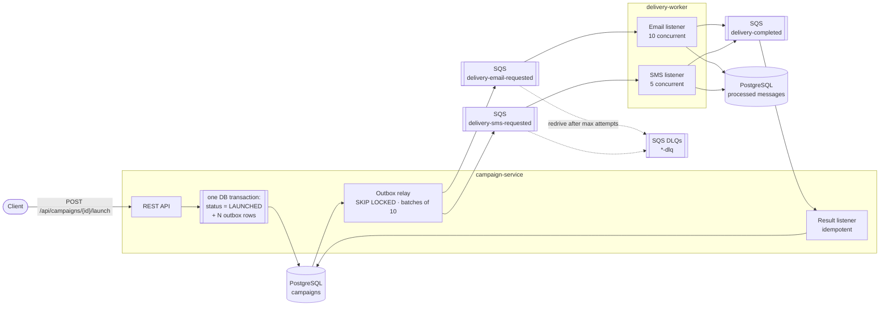

# Event-Driven Campaign Platform

[](https://github.com/shubhajit93/event-driven-campaign-platform/actions/workflows/ci.yml)


A multi-channel (email and SMS) campaign delivery system built with **Java 21, Spring Boot, AWS SQS, and PostgreSQL**. It's a compact, runnable reference for the patterns that keep queue-based systems correct under failure:

- **Transactional outbox:** no lost or phantom messages, without distributed transactions
- **Idempotent consumers:** SQS delivers at least once, but each message takes effect in the database exactly once
- **Per-channel queues:** separate queues and consumer pools, so one slow provider can't stall the others
- **Retries through SQS itself:** exponential backoff via the visibility timeout, then a **dead-letter queue** through a redrive policy
- **Production packaging:**
  - integration tests against real SQS (LocalStack) and PostgreSQL
  - an end-to-end Docker Compose test in CI
  - Kubernetes with IRSA
  - Terraform for queues, DLQs, and least-privilege IAM

> I built this from scratch as an open-source version of the campaign pipeline I lead at work. That system's code is proprietary; see the [case study](https://github.com/shubhajit93/security-awareness-platform-case-study). This repo keeps the production design and adds the two guarantees on that system's roadmap: a transactional outbox and idempotent consumers.

### How it maps to the production system

| | Production pipeline | This repo |
|---|---|---|
| Queues | One SQS queue per workload and environment (email, SMS, voice, AI, speech-to-text, video), each with a DLQ | One per channel (email, SMS) plus results, each with a DLQ |
| Retries | Visibility timeout, then redrive to the DLQ after 5 receives | The same, plus exponential backoff by changing the visibility timeout |
| Publishing | Database write, then enqueue | **Transactional outbox** with a `SKIP LOCKED` relay |
| Duplicates | Possible (at-least-once) | **Idempotent consumers**, so each message takes effect exactly once |
| Stack | Reactive Spring Boot, MongoDB | Spring Boot (servlet), PostgreSQL, so the outbox and idempotency are plain SQL transactions |
| Infrastructure | Terraform: queues, DLQs, per-queue IAM | Terraform: queues, DLQs, least-privilege IAM per service |

---

## Architecture



### What happens on launch

1. `POST /launch` locks the campaign row, fans it out into one delivery per recipient per reachable channel, and stores the status change **and** all delivery messages in **a single local transaction** (the outbox).
2. The **outbox relay** polls unpublished rows with `FOR UPDATE SKIP LOCKED`, so any number of replicas can relay in parallel. It sends them with `SendMessageBatch` (up to 10 per call) and marks rows as sent **only when SQS has accepted every entry**.
3. **delivery-worker** listens to each channel queue with its own concurrency. Inside one transaction it records the message id (the idempotency key), calls the provider, and sends a `DeliveryCompleted` result to `delivery-completed`.
4. **campaign-service** applies each result exactly once, using its own processed-message table and atomic SQL counters. It marks the campaign `COMPLETED` when every delivery has an outcome.

### Failure handling

| Failure | Behavior |
|---|---|
| Service crashes after commit, before sending | The outbox row is still unpublished, so the relay sends it on restart |
| SQS unavailable, or a batch partly rejected | The relay rolls back and retries the whole batch next tick. Any duplicates are absorbed by consumers |
| Duplicate message (SQS at-least-once, relay retry) | The insert into `processed_messages` is a no-op, so the message is skipped |
| Provider timeout or throttling (`TransientDeliveryException`) | The transaction rolls back (including the idempotency mark). The message isn't deleted, and its **visibility timeout is set to the backoff** (2s, 4s, 8s, ...), so it comes back later on any worker |
| Final attempt fails | A `FAILED` result is reported so the campaign still completes. The visibility drops to 0, and the **redrive policy moves the message to the DLQ** for inspection and replay |
| Invalid address (`PermanentDeliveryException`) | Reported as `FAILED` right away, with no retries |
| Malformed payload | Released immediately (visibility 0) and redriven to the DLQ |
| Two concurrent launch requests | A pessimistic row lock means one wins and the other gets `409 Conflict` |

### Why SQS for this workload

- **Each delivery is independent.** A campaign doesn't need ordering, so standard queues give near-unlimited throughput, with no partitions to plan and no brokers to run.
- **Retries and dead-lettering are built in.** The visibility timeout and redrive policy *are* the retry mechanism, so no message is ever held in a worker's memory while it waits to be retried.
- **Scaling is just adding consumers.** There's no partition count to cap parallelism, and queue depth is a direct autoscaling signal (KEDA `aws-sqs-queue`).
- **The cost of that choice:** at-least-once delivery and no ordering. That's why idempotent consumers and SQL counters (rather than read-modify-write) are mandatory, not optional.

## Run it

**Requirements:** JDK 21 and Docker.

```bash
./gradlew bootJar
docker compose up --build        # PostgreSQL, LocalStack (SQS + DLQs), both services
./scripts/smoke-test.sh          # creates and launches a campaign, waits for COMPLETED
```

The compose file makes 20% of simulated sends fail transiently, so the worker logs show retries with backoff. Like payment providers' test card numbers, any address containing `flaky` (for example `x@flaky.example`) **always** fails transiently, so you can watch a message exhaust its retries and land in the DLQ:

```bash
docker compose exec localstack awslocal sqs receive-message \
  --queue-url http://localhost:4566/000000000000/delivery-email-requested-dlq
```

Or drive the API yourself:

```bash
curl -s -X POST localhost:8081/api/campaigns -H 'Content-Type: application/json' -d '{
  "name": "Product launch",
  "template": "Hi {{name}}, it is live!",
  "channels": ["EMAIL", "SMS"],
  "recipients": [
    {"name": "Alice", "email": "alice@example.com", "phone": "+8801700000000"},
    {"name": "Bob",   "email": "bob@example.com"}
  ]
}'
curl -s -X POST localhost:8081/api/campaigns/<id>/launch   # 202 Accepted
curl -s localhost:8081/api/campaigns/<id>                   # watch delivered/failed move to COMPLETED
```

Metrics are at `/actuator/prometheus` on both services. Look for `campaign_deliveries_total{channel,status}` and `campaign_deliveries_duplicates_total`.

## Tests

```bash
./gradlew build
```

- **Unit tests:**
  - domain fan-out rules and template rendering
  - the retry policy's backoff schedule
  - the listener's retry decisions: backoff, final attempt, unreadable payload
  - the delivery service's duplicate, permanent, transient, and exhausted paths
- **Integration tests** (Testcontainers: PostgreSQL + LocalStack SQS, with queues created by the same script docker-compose uses):
  - The full create → launch → outbox → SQS → results → `COMPLETED` flow, including a duplicate result that must not be counted twice
  - A duplicate request in the worker that must produce exactly one result
  - A delivery that keeps failing transiently. It must be retried, reported as `FAILED`, and **land in the DLQ via the real redrive policy**
- **End-to-end test** (CI): starts the whole Docker Compose stack and runs `scripts/smoke-test.sh`.

The integration tests skip themselves when Docker isn't available. CI fails the build if any test is skipped.

## Project layout

```text
campaign-api/       Shared message contracts (records) and queue names. No framework code
campaign-service/   REST API, Campaign aggregate, outbox writer and SQS relay, result listener
delivery-worker/    Per-channel SQS listeners, idempotency, retry policy, provider port
docker/             LocalStack queue + DLQ setup, PostgreSQL databases
deploy/k8s/         Kustomize: Deployments with probes and security context, IRSA service accounts, HPA
deploy/terraform/   AWS: SQS queues + DLQs + redrive, least-privilege IAM per service, ECR, Secrets Manager
.github/workflows/  Build and test → validate IaC → compose end-to-end → push images to GHCR
```

## Design notes

- **Why an outbox instead of sending in the request?** Writing to the database and then to SQS is a dual write. A crash between the two either loses messages or sends messages for a change that rolled back. The outbox turns it into one local transaction plus a retryable relay.
- **Why the idempotency mark sits in the same transaction as the work:** if the provider call fails, the mark rolls back with everything else, so the retry isn't mistaken for a duplicate.
- **Why `maxAttempts` equals the redrive `maxReceiveCount`:** the app reports the final failure, and SQS does the dead-lettering. Each takes care of its own part, and no message is ever deleted without an outcome.
- **Why counters are updated in SQL:** `delivered = delivered + 1` is atomic under concurrent consumers. A read-modify-write through JPA would lose updates.
- **Why `queue-not-found-strategy: fail`:** an auto-created queue would have no DLQ. Queues come only from Terraform (or LocalStack locally).

## What I'd add next

- Per-provider rate limiting (token bucket in Redis), so throttling is avoided rather than retried
- KEDA autoscaling on queue depth instead of CPU
- OpenTelemetry tracing propagated through SQS message attributes
- A DLQ redrive runbook and an alarm on DLQ depth (CloudWatch `ApproximateNumberOfMessagesVisible`)

---

Built by [Shubhajit Nandi](https://github.com/shubhajit93), Senior Backend Engineer · [LinkedIn](https://www.linkedin.com/in/shubhajit-nandi/)
