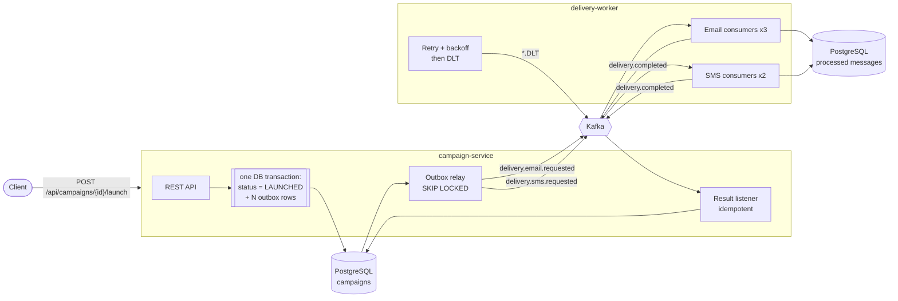

# Event-Driven Campaign Platform

[](https://github.com/shubhajit93/event-driven-campaign-platform/actions/workflows/ci.yml)


A multi-channel (email and SMS) campaign delivery system built with **Java 21, Spring Boot, Kafka, and PostgreSQL**. It's a compact, runnable reference for the patterns that keep event-driven systems correct under failure:

- **Transactional outbox:** no lost or phantom events, without distributed transactions
- **Idempotent consumers:** at-least-once delivery from Kafka, exactly-once effect in the database
- **Per-channel isolation:** separate topics and consumer pools, so one slow provider can't stall the others
- **Retry with backoff, then a dead-letter topic:** transient and permanent failures are handled differently
- **Production packaging:** Testcontainers integration tests, Docker Compose, Kubernetes manifests, Terraform, and GitHub Actions

> I built this from scratch to show, in open source, the architecture patterns I use in production at work, where the code itself is proprietary. See the [case study](https://github.com/shubhajit93/security-awareness-platform-case-study) for that system.

---

## Architecture



### What happens on launch

1. `POST /launch` locks the campaign row, fans it out into one delivery per recipient per reachable channel, and stores the status change **and** all delivery events in **a single local transaction** (the outbox).
2. The **outbox relay** polls unpublished rows with `FOR UPDATE SKIP LOCKED`, so any number of replicas can relay in parallel. It publishes to the channel's topic and marks a row as sent **only after the broker acknowledges it**.
3. **delivery-worker** consumes each channel with its own consumer pool. Inside one transaction it records the message id (the idempotency key), calls the provider, and publishes a `DeliveryCompleted` result.
4. **campaign-service** applies each result exactly once, using its own processed-message table and atomic SQL counters. It marks the campaign `COMPLETED` when every delivery has an outcome.

### Failure handling

| Failure | Behavior |
|---|---|
| Service crashes after commit, before publishing | The outbox row is still unpublished, so the relay publishes it on restart |
| Kafka unavailable | The relay keeps rows and retries every tick, and the API keeps accepting launches |
| Duplicate message (redelivery, rebalance, relay retry) | The insert into `processed_messages` is a no-op, so the message is skipped |
| Provider timeout or throttling (`TransientDeliveryException`) | The transaction rolls back (including the idempotency mark), then up to 4 retries with exponential backoff |
| Retries exhausted | The record goes to `<topic>.DLT` for replay, and a `FAILED` result is reported so the campaign still completes |
| Invalid address (`PermanentDeliveryException`) | Reported as `FAILED` right away, with no retries |
| Malformed payload | Not retryable, so it goes straight to the DLT |
| Two concurrent launch requests | A pessimistic row lock means one wins and the other gets `409 Conflict` |

## Run it

**Requirements:** JDK 21 and Docker.

```bash
./gradlew bootJar
docker compose up --build
```

The compose file makes 20% of simulated sends fail transiently, so retries and dead-lettering show up in the worker logs.

```bash
# Create a campaign
curl -s -X POST localhost:8081/api/campaigns -H 'Content-Type: application/json' -d '{
  "name": "Product launch",
  "template": "Hi {{name}}, it is live!",
  "channels": ["EMAIL", "SMS"],
  "recipients": [
    {"name": "Alice", "email": "alice@example.com", "phone": "+8801700000000"},
    {"name": "Bob",   "email": "bob@example.com"},
    {"name": "Eve",   "email": "eve@example.com", "phone": "12345"}
  ]
}'

# Launch it (returns 202 Accepted), then watch the counters move to COMPLETED
curl -s -X POST localhost:8081/api/campaigns/<id>/launch
curl -s localhost:8081/api/campaigns/<id>
```

Metrics are at `/actuator/prometheus` on both services. Look for `campaign_deliveries_total{channel,status}` and `campaign_deliveries_duplicates_total`.

## Tests

```bash
./gradlew build
```

- **Unit tests:** domain fan-out rules, template rendering, and the delivery service's duplicate, permanent, transient, and exhausted paths.
- **Integration tests** (Testcontainers, real PostgreSQL and Kafka):
  - The full create → launch → outbox → Kafka → results → `COMPLETED` flow, including a duplicate result that must not be counted twice
  - A redelivered request in the worker that must produce exactly one result

The integration tests are skipped automatically when Docker isn't available, and always run in CI.

## Project layout

```text
campaign-api/       Shared event contracts (records) and topic names. No framework code
campaign-service/   REST API, Campaign aggregate, outbox writer and relay, result listener
delivery-worker/    Per-channel consumers, idempotency, retry/DLT error handling, provider port
deploy/k8s/         Kustomize: Deployments with probes, security context, HPA, ConfigMap
deploy/terraform/   AWS: ECR (immutable tags, lifecycle), Secrets Manager DB credentials
.github/workflows/  Build and test → validate IaC → push images to GHCR
```

## Design notes

- **Why an outbox instead of publishing in the request?** Writing to the database and then to Kafka is a dual write. A crash between the two either loses events or publishes events for a change that rolled back. The outbox turns it into one local transaction plus a retryable relay.
- **Why per-channel topics?** Email and SMS have different throughput, cost, and rate limits. Separate topics and listener containers let each scale, retry, and fail on its own.
- **Why the idempotency mark sits in the same transaction as the work:** if the provider call fails, the mark rolls back with everything else, so the retry isn't mistaken for a duplicate.
- **Why counters are updated in SQL:** `delivered = delivered + 1` is atomic under concurrent consumers. A read-modify-write through JPA would lose updates.

## What I'd add next

- Partition-aware rate limiting per provider (token bucket in Redis)
- Consumer-lag autoscaling with KEDA instead of CPU-based HPA
- OpenTelemetry tracing propagated through Kafka headers
- Debezium CDC as an alternative to the polling relay, at higher volumes

---

Built by [Shubhajit Nandi](https://github.com/shubhajit93), Senior Backend Engineer · [LinkedIn](https://www.linkedin.com/in/shubhajit-nandi/)
